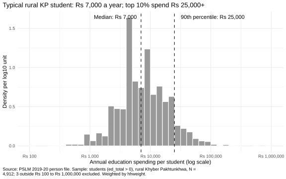
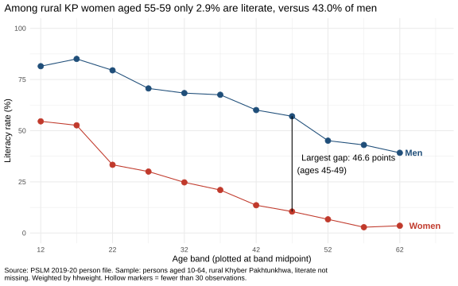
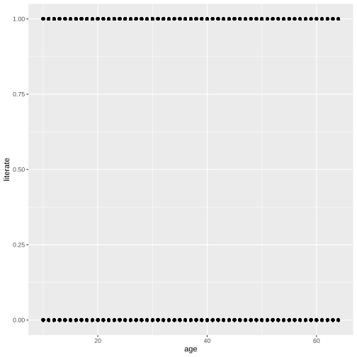
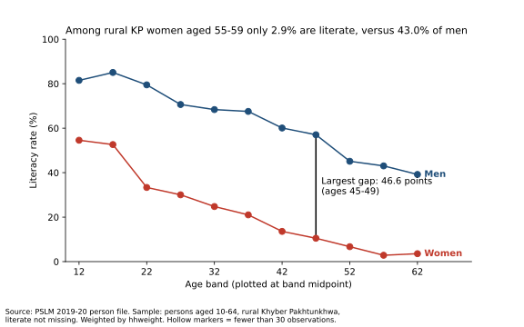

# ECO346 Assignment 1: Education spending and literacy in rural Khyber Pakhtunkhwa

**Name:** Uswah Zahid | **Reg. no.:** FA24-BED-076 | **Section:** B

## Variant
Last two digits 76 = 9 × 8 + 4, so **variant 4: Khyber Pakhtunkhwa, rural**
(`prov_code == 1`, `urban_rural == 1`).

## How to run
Run the scripts in `scripts/` in order. Each reads the CSV files in `data/` and saves SVG figures to `figures/`.
1. `01_default.R` (default scatterplot)
2. `02_distribution.R` (histogram of education spending)
3. `03_literacy.R` (literacy by age band)
4. `04_literacy.py` (Python reproduction)

## Figure 1: Distribution of education spending

N = 4,912 students; weighted median Rs 7,000; unweighted median Rs 7,000; weighted 10th percentile Rs 2,500; weighted 90th percentile Rs 25,000; ratio 10.00; 3 excluded.

The figure shows that most students' education spending falls between Rs 2,500 and Rs 25,000, with a long tail towards higher spending. The 10th percentile is Rs 2,500 and the 90th percentile is Rs 25,000, giving a ratio of 10.00. The weighted and unweighted medians are both Rs 7,000. This is because, with and without weights, the cumulative share reaches 50% at the same spending value. 3 students fall outside the Rs 100 to Rs 1,000,000 range.   

## Figure 2: Literacy by age band

| Band | Women (persons) | Women (%) | Men (persons) | Men (%) |
|---|---|---|---|---|
| 10-14 | 1210 | 54.6 | 1439 | 81.5 |
| 15-19 | 985 | 52.6 | 1162 | 85.1 |
| 20-24 | 906 | 33.3 | 768 | 79.5 |
| 25-29 | 826 | 30.0 | 580 | 70.6 |
| 30-34 | 588 | 24.8 | 499 | 68.4 |
| 35-39 | 546 | 21.0 | 421 | 67.5 |
| 40-44 | 449 | 13.6 | 357 | 60.1 |
| 45-49 | 392 | 10.5 | 385 | 57.0 |
| 50-54 | 384 | 6.7 | 278 | 45.1 |
| 55-59 | 308 | 2.9 | 255 | 43.0 |
| 60-64 | 190 | 3.6 | 272 | 39.2 |

The figure shows that women's literacy rates are lower than men's in every age group, and literacy is generally lower in older age groups for both genders. Among people aged 15-19, literacy is 52.6% for women and 85.1% for men. The largest gender gap is 46.6 percentage points in the 45-49 age group. For ages 55-59, the rates are 2.9% for women and 43.0% for men. It compares different people at one time, so age and cohort effects can't be separated. Older women may be less literate because of the schooling available when they were young.  

## The makeover
Default figure: 

First, I plotted the weighted average literacy rate (a conditional mean) for each age group instead of individual 0/1 observations, reducing overplotting and making the pattern clearer. Second, I used a 0-100% axis so values could be compared by position on a common scale, the most accurate channel in the perceptual ranking of channels. Third, I added direct labels to the lines instead of a legend, so readers do not have to match colors to a legend. I also removed the grey background and unnecessary gridlines to follow the data-ink principle. Finally, I added a title stating the main finding and an annotation of the largest gap to guide the reader's attention to the key pattern. However, the redesigned figure hides the individual observations and exact ages shown in the default figure, so the variation within each age group is less visible. 

## Second language (Python)

One difference between R and Python was how text was handled in SVG files. Matplotlib converts text into shapes by default, while R keeps it as text. I set svg.fonttype = "none" in Python, which made the output more consistent with R. The tables matched because both use the same weighted formula and the same left-closed age bands. For women aged 15-19, both reported a literacy rate of 52.6%, and all 22 rows agreed to one decimal place.   
